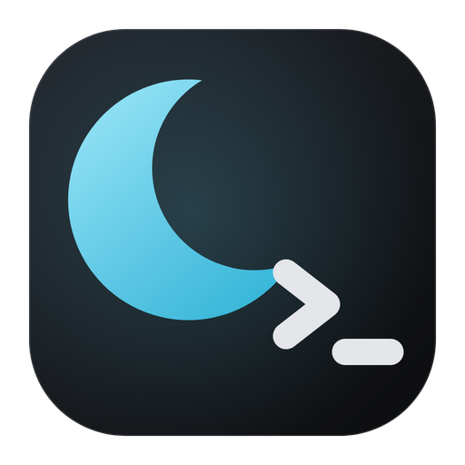
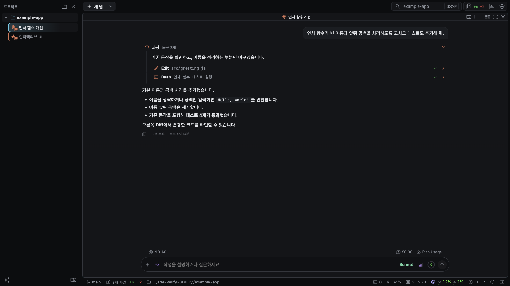
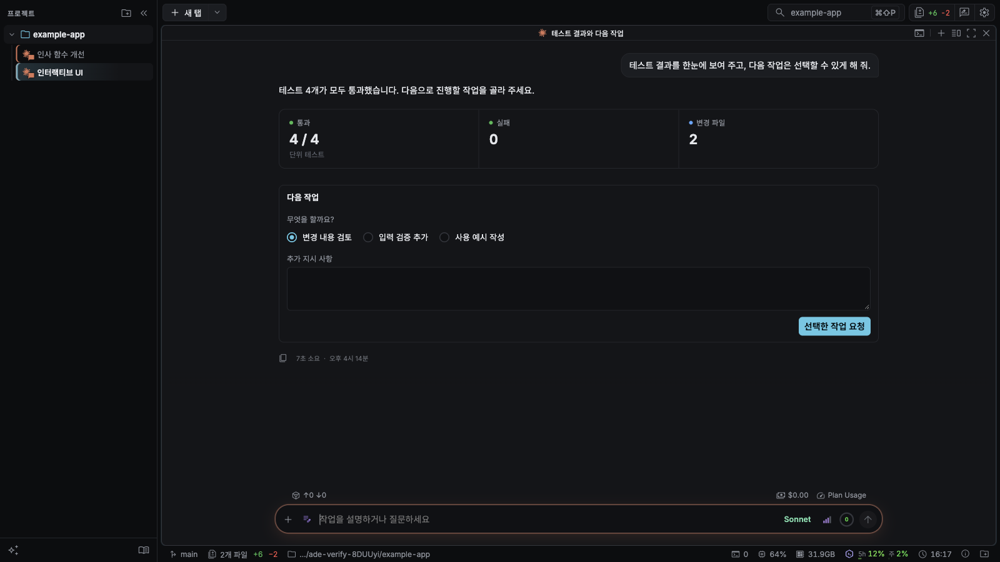
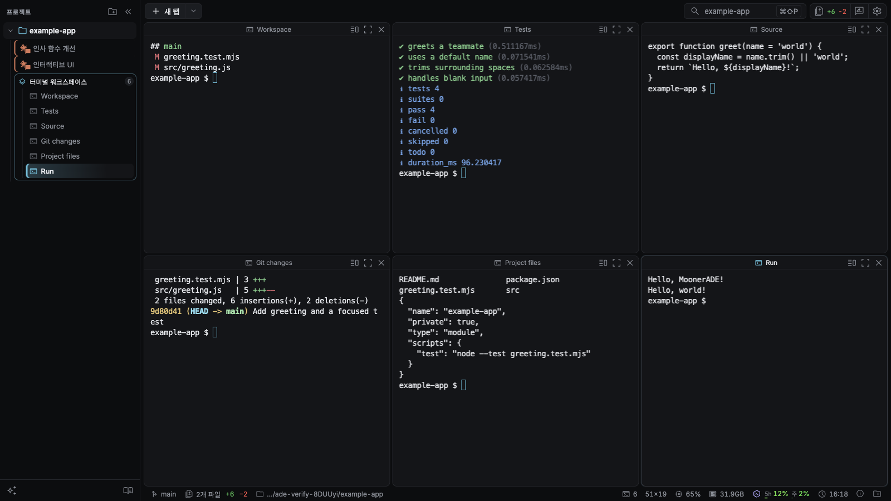
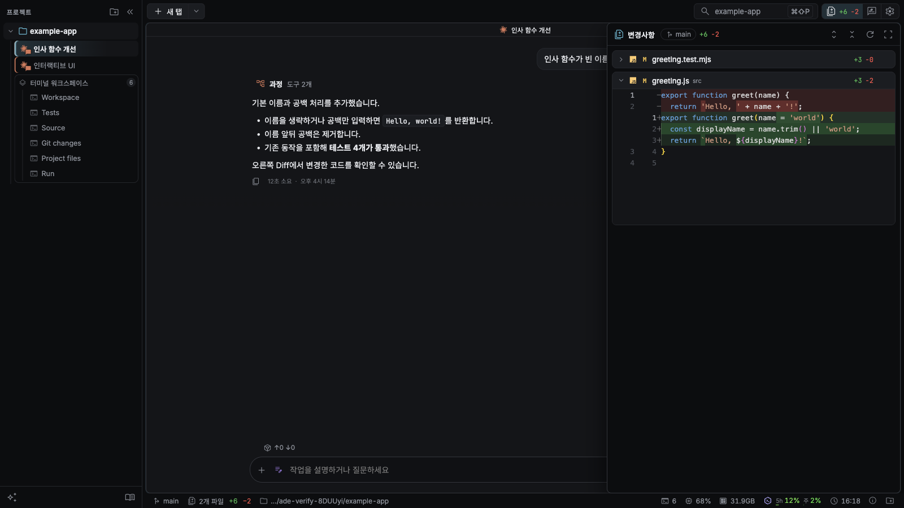

<p align="center">
  
</p>

# MoonerADE · 무너에이드

**Claude Code · Codex · Cursor Agent를 한 창에서.**

채팅과 터미널로 에이전트에게 일을 맡기고, 여러 프로젝트를 오가며 결과를 확인하는 macOS·Windows 개발 워크스페이스입니다. 컴퓨터에 설치된 공식 CLI와 계정을 그대로 사용합니다.

[설치](#설치) · [사용법](#사용법) · [주요 기능](#주요-기능) · [개발](#개발) · [문서](#문서) · [릴리스](https://github.com/Mooner510/mooner-ade/releases)



*현재 소스로 촬영한 예제 화면입니다. 대화·사용량·카드 수치는 시연용이며, 터미널 출력은 예제를 실제 실행한 결과입니다.*

## 설치

**macOS Apple Silicon**과 **Windows x64**용 앱을 제공합니다. 아래 명령은 최신 릴리스를 설치하고 앱을 실행합니다. 관리자 권한은 필요하지 않습니다.

### macOS

터미널에서 실행하세요.

```sh
curl -fsSL https://raw.githubusercontent.com/Mooner510/mooner-ade/master/scripts/install-mac.sh | sh
```

설치 위치는 `/Applications/MoonerADE.app`이며, 해당 폴더에 쓸 수 없으면 `~/Applications`를 사용합니다.

### Windows

PowerShell에서 실행하세요.

```powershell
irm https://raw.githubusercontent.com/Mooner510/mooner-ade/master/scripts/install-windows.ps1 | iex
```

`%LOCALAPPDATA%\Programs\MoonerADE`에 설치하고 시작 메뉴·바탕 화면에 바로 가기를 만듭니다.

> 설치 명령을 다시 실행하면 기존 앱을 종료하고 교체합니다. 설치 후에는 앱 안의 자동 업데이트를 사용하세요. Intel Mac 등 다른 환경은 [소스에서 실행](#소스에서-실행)을 참고하세요.

### 에이전트 준비

[Git](https://git-scm.com/downloads)과 사용할 에이전트의 공식 CLI를 설치한 뒤 로그인하세요. 에이전트는 하나만 준비해도 됩니다.

| 에이전트 | 설치 안내 | 로그인 명령 |
|---|---|---|
| Claude Code | [공식 안내](https://docs.anthropic.com/claude-code) | `claude auth login` |
| Codex | [공식 안내](https://github.com/openai/codex) | `codex login` |
| Cursor Agent | [공식 안내](https://cursor.com/docs/cli/overview) | `cursor-agent login` |

채팅은 **설정 → AI 툴 → 각 에이전트 → 채팅 인증**에서 API 키를 사용할 수도 있습니다. 이 설정은 채팅에만 적용되며, 터미널과 상태바 사용량 조회는 CLI 로그인을 사용합니다. 모델 이용 권한과 비용은 각 제공자의 계정·플랜을 따릅니다.

<details>
<summary>설치 참고 · Windows 화면 끊김 · 삭제</summary>

- **macOS 서명:** 배포 앱은 Apple 공증 없이 자체 인증서로 서명됩니다(`docs/MAC_SIGNING.md`). 업데이트해도 문서·다운로드 폴더 같은 권한 승인이 유지됩니다. 설치 스크립트는 앱의 격리 속성을 제거합니다.
- **Windows ARM:** 제공하는 x64 앱은 Windows의 x64 에뮬레이션을 사용합니다.
- **NVIDIA RTX HDR:** NVIDIA App의 RTX HDR이 앱에 적용되면 화면이 끊길 수 있습니다. 앱이 감지해 제안하는 **해결**을 누르면 관리자 권한 확인 후 MoonerADE에만 RTX HDR을 끄는 프로필을 추가합니다. 직접 설정하려면 NVIDIA App → 그래픽 → 프로그램 설정에서 MoonerADE의 RTX HDR을 끄세요.

RTX HDR 프로필을 되돌리려면 관리자 PowerShell에서 실행합니다.

```powershell
& "$env:LOCALAPPDATA\Programs\MoonerADE\resources\app\apps\desktop\src\nvidia-profile.ps1" -Exe moonerade.exe -ProfileName MoonerADE -Undo -Result "$env:TEMP\ade-nvidia.txt"
```

**앱 삭제:** 앱과 백그라운드 작업을 종료한 뒤 macOS는 설치된 `MoonerADE.app`을, Windows는 설치 폴더와 바로 가기를 지우세요. 설정·기록까지 삭제하려면 다음 폴더도 지웁니다. 실제 프로젝트와 CLI 자체 설정은 별도입니다.

| OS | 앱 데이터 | Electron 프로필 |
|---|---|---|
| macOS | `~/Library/Application Support/mooner-ade` | `~/Library/Application Support/@mooner/ade-desktop` |
| Windows | `%LOCALAPPDATA%\mooner-ade` | `%APPDATA%\@mooner\ade-desktop` |

</details>

## 사용법

1. **프로젝트 열기:** 사이드바에서 작업 폴더를 추가합니다. 첫 실행의 둘러보기에서 기본 조작을 연습할 수 있습니다.
2. **에이전트 시작:** 새 탭에서 **Chat** 또는 **CLI** 모드와 에이전트를 고릅니다. 일반 터미널도 열 수 있습니다.
3. **작업 확인:** 채팅의 도구·질문·승인 카드를 확인하거나, 여러 칸으로 분할해 에이전트와 로그를 나란히 봅니다. 커밋 기록은 상단 **Git** 버튼(커밋하지 않은 `+/−` 줄 수 표시)으로 여는 IntelliJ식 커밋 그래프에서 보고, 체크아웃·브랜치·머지·리베이스·체리픽도 거기서 합니다.

프로젝트 목록·탭·화면 배치는 자동 저장됩니다. 둘러보기는 사이드바 아래 책 버튼으로 다시 열 수 있습니다.

### 자주 쓰는 단축키

`mod`는 macOS의 ⌘, Windows의 Ctrl입니다. 설정에서 단축키를 바꿀 수 있고, 명령 팔레트의 모든 명령에 키를 정할 수 있습니다.

| 단축키 | 동작 |
|---|---|
| `mod+Alt+O` | 프로젝트 열기 |
| `mod+Shift+T` | 새 탭 |
| `mod+Shift+N` | 새 탭에서 실행할 도구 고르기 |
| `mod+Shift+P` / `F1` | 명령 팔레트 (`>` 명령, `#` 탭·채팅, `@` 파일, `,` 설정) |
| `mod+/` | 단축키 한눈에 보기 |
| `mod+Alt+C` | 어디서든 채팅 입력창으로 돌아가기 |
| `Alt+0` | 사이드바의 현재 탭으로 (화살표로 이동) |
| `mod+Alt+.` / `mod+Alt+,` | 다음 / 이전 확인 필요 탭 (질문·승인 먼저, 모든 프로젝트) |
| `Alt+Shift+1…9` | 이 탭의 N번째 pane으로 |
| `Ctrl+D` / `Ctrl+Shift+D` | 좌우 / 상하 분할 (macOS도 Ctrl, 편집기 안의 `Ctrl+D`는 편집기 몫) |
| `mod+Shift+Enter` | 현재 칸 최대화 / 복원 |
| `mod+Shift+G` | Git 커밋 그래프 |
| `mod+,` | 설정 |

전체 단축키와 세션 복구 방법은 [사용 안내](docs/LOCAL_IDE.md)를 참고하세요.

## 주요 기능

### 에이전트의 작업을 읽기 쉬운 채팅으로

명령 실행과 파일 변경을 접을 수 있는 카드로 보여 주고, 질문·승인·계획 검토는 화면에서 답할 수 있습니다. 서브에이전트의 작업과 모델·Effort도 확인할 수 있습니다. 이미지 붙여넣기와 파일 끌어놓기, `@` 파일 언급, `/resume`으로 이전 대화 불러오기도 지원합니다.

입력창에서 권한 모드·모델·Effort를 고르고, 상태 줄에서 컨텍스트·토큰·비용을 확인하세요. **새 채팅은 프로젝트에서 마지막으로 고른 설정을 이어받습니다.** 제공되는 항목은 에이전트와 CLI 버전에 따라 다릅니다.

<details>
<summary>에이전트별 채팅 지원 범위</summary>

| 기능 | Claude Code | Codex | Cursor Agent |
|---|---|---|---|
| 채팅·이미지·파일 첨부 | 지원 | 지원 | 지원 |
| 응답 중 추가 지시 | 지원 | 지원 | 대기열 / 중단 후 바로 전송 |
| 과거 대화에서 분기·되돌리기 | 지원 | 지원 | 분기 기록을 저장한 완료 응답에서 지원 |
| 누적 입출력 토큰 / 비용 표시 | 지원 / 지원 | 지원 / 미제공 | 제공자가 보고하면 표시 / API 키·계정별 조건부 조회 |
| 컨텍스트 토큰·사용률 | 지원 | 지원 | 지원 |
| 프롬프트 캐시 타이머 | 지원 | 만료 시각 미제공 | 만료 시각 미제공 |
| 세션 통계(`/stats`) | 지원 | 지원 | 지원 (제공된 항목만 표시) |
| 채팅 → 터미널 전환 | 지원 | 지원 | 지원 |
| 터미널 → 채팅 전환 | 작업이 끝난 로컬 세션에서 지원 | 중단 확인 후 같은 세션으로 전환 | 대화 선택·중단 확인 후 복사본으로 전환 |

이미지 입력·세션 복원 등은 CLI와 모델이 지원하는 범위에서 동작합니다. 사용할 수 없는 기능은 화면에서 이유를 안내합니다. 자세한 동작은 [채팅 기능 정리](CHAT_MODE_FEATURES.md), 확인한 범위는 [검증 상태](docs/VERIFICATION.md)를 참고하세요.

터미널 전환은 로컬 세션을 대상으로 하며 미전송 입력은 보존하지 않습니다. Cursor의 채팅↔터미널 전환은 원본을 보존한 새 세션으로 대화 문맥을 복사합니다. Cursor 분기 기록은 이 기능 적용 뒤 완료한 응답부터 저장하며, 원본 저장소 형식이 바뀌면 전환을 거절할 수 있습니다. `/stats`의 Codex·Cursor 통계는 ADE에 보관된 대화 범위이며 모델 API 호출 수·미제공 토큰·비용을 추정하지 않습니다.

</details>

### 답변 안에서 선택하고 조작하는 인터랙티브 UI

에이전트가 답변에 상태 카드·차트·입력 폼을 넣고, 계산기나 미리보기를 보여 줄 수 있습니다. 폼에서 고른 내용을 다음 요청으로 보내거나 입력창에 채웁니다. 미리보기 코드는 격리된 샌드박스에서 실행됩니다.



**설정 → AI 툴 → Claude Code → 인터랙티브 UI**에서 켜고 끌 수 있습니다. 기본으로 켜져 있으며, 변경은 새 채팅부터 적용됩니다.

### 여러 프로젝트와 터미널을 한 화면에

프로젝트마다 탭과 배치를 유지하고, 좌우·상하 분할과 크기 조절·최대화를 지원합니다. 명령 팔레트에서 **2 × 3 그리드**도 한 번에 만들 수 있습니다. 에이전트의 질문·승인·완료 상태는 사이드바와 알림으로 확인합니다.



### 바뀐 코드를 바로 검토

상단 **Git** 버튼으로 아래에서 올라오는 Git 커밋 그래프를 열고, 커밋의 변경 파일을 더블클릭하면 편집기 영역에 diff 탭이 열립니다. diff는 통합 또는 좌우 비교로 볼 수 있습니다. 여러 저장소가 있는 프로젝트는 커밋 그래프 머리줄에서 저장소를 고릅니다.

상단 바의 **프로젝트 파일 트리**에서 파일을 열면 ADE 편집기(Monaco)에서 바로 고치고 `mod+S`로 저장할 수 있습니다. 편집 중에 에이전트가 같은 파일을 바꾸면 덮어쓰지 않고 충돌로 알립니다.

<details>
<summary>채팅과 Diff를 함께 보는 화면 (이전 버전 화면)</summary>



</details>

diff 탭은 **읽기 전용**입니다. 파일 내용 전체 검색과 스테이징·커밋 화면은 없으니 터미널이나 에이전트를 사용하세요. 저장소별 worktree를 켜면 작업 경로를 나눌 수 있으며, 원본으로 통합할 때는 커밋 후 fast-forward만 지원합니다.

### 작업을 이어 가는 도구

| 기능 | 사용 방법 |
|---|---|
| **사용량·캐시** | 상태바에서 제공자별 사용 한도를 확인하고, Claude 채팅·터미널에서 프롬프트 캐시 타이머 확인 |
| **세션 통계** | Claude 채팅의 `/stats`에서 컨텍스트 변화·턴 시작점·턴별 비용 추정치 확인 |
| **플러그인·에이전트 버스** | 승인한 플러그인으로 도구를 추가하고, 내장 버스로 ADE의 채팅 에이전트끼리 메시지 교환 |
| **피드백 요청** | `mod+Alt+F`로 열어 화면 캡처·주석과 함께 개선 요청 작성. AI 초안도 사람이 검토한 뒤 제출 |
| **WakaTime** | 설정 → WakaTime에서 앱 사용 시간·에이전트 작업 시간 기록 |
| **화면 맞춤** | 테마·강조 색·글꼴·상태바·알림 설정 |
| **변경 내역** | 사이드바 아래 변경 내역에서 버전별 새 기능·수정 사항 확인 |

### Claude가 일하는 동안 다음 요청 예약하기

**터미널의 Claude Code가 작업 중일 때** 다음 요청을 입력하고 **Tab**을 누르세요. 입력을 비워 예약 목록에 넣고, 현재 작업이 끝나면 순서대로 보냅니다. 목록에서 수정·취소할 수 있습니다.

Claude Code **2.1.303 이상**과 ADE에서 새로 연 터미널이 필요합니다. 작업 중이 아니거나 `/`·`@`로 시작하는 입력, Codex와 일반 셸의 Tab은 평소대로 동작합니다.

<details>
<summary>예약의 완료 감지·호환 조건·유지 범위</summary>

- Claude의 OSC 7501(없으면 OSC 9;4) 상태 신호와 빈 입력란을 확인하고, 서버에서 Claude 프로세스·화면 출력 순번을 다시 검증합니다. 질문·승인 화면이나 작성 중인 입력이 있으면 기다립니다.
- 구버전, `terminalProgressBarEnabled`가 꺼진 세션, SSH 세션, 신호가 전달되지 않는 tmux 환경에서는 동작하지 않습니다. 기존 터미널에는 새 환경 설정이 적용되지 않으므로 새 터미널을 열어야 합니다. 원격 tmux의 상태 표시는 [사용 안내](docs/LOCAL_IDE.md)를 참고하세요.
- **Esc·Ctrl+C 중단이나 오류도 현재 작업의 종료로 봅니다.** 재연결 후 이미 유휴 상태여도 다음 예약을 보내며, 전송을 거절당하면 다음 갱신 때 다시 시도합니다. 예약을 멈추려면 목록에서 취소하세요.
- 예약은 **텍스트만, 메모리에만** 보관합니다. 이미지 첨부는 예약하지 않으며, 앱 새로고침·종료·칸 재생성 시 사라집니다.

</details>

### 자동 업데이트와 백그라운드 실행

설치한 앱은 시작 5초 뒤와 10분마다 업데이트를 확인합니다. 설정 → 정보의 **업데이트 자동 다운로드**는 기본으로 켜져 있습니다. 새 버전을 백그라운드에서 받아 준비한 뒤 **종료할 때 업데이트**, **지금 업데이트**, **나중에**를 표시합니다. **나중에**를 고르면 현재 실행 중인 앱의 사이드바 하단에서 **지금 적용**을 누를 수 있습니다.

자동 다운로드를 끄면 다운로드 전에 확인합니다. 이 모드에서는 업데이트로 재시작하기 직전에 10초 카운트다운이 표시됩니다. 설정 → 정보의 **업데이트 카운트다운 위치**에서 표시할 위치를 고를 수 있으며 기본값은 중앙입니다. 두 모드 모두 다운로드와 설치 준비 중에는 사이드바 하단에서 진행률을 보면서 작업을 계속할 수 있고, 설정에서 직접 업데이트를 확인할 수 있습니다.

업데이트 재시작 동안 터미널·채팅 작업을 유지하고 새 창에 다시 연결합니다. 앱을 닫을 때는 **백그라운드로 남기기**를 선택해 작업을 이어 가거나, **종료**로 함께 끝낼 수 있습니다. **종료할 때 업데이트**를 골랐다면 **종료** 대신 **업데이트하고 다시 시작**이 나오고, 업데이트를 설치한 뒤 터미널과 채팅은 새 창에서 이어집니다.

<details>
<summary>복원 조건과 예외</summary>

- 업데이트 중 유지되는 프로세스는 별도 PTY 호스트가 관리합니다. 앱이 5분 안에 다시 뜨지 않으면 정리합니다. 백그라운드 유지는 다음 실행까지 계속됩니다.
- 호스트를 시작하지 못했거나 이전 호스트가 채팅 유지 기능을 지원하지 않으면 작업이 끊길 수 있습니다. 앱은 실제 유지 가능 범위를 확인해 종료·업데이트 대화상자에서 안내합니다.
- 일반 새로고침은 실행 중인 터미널에 다시 연결합니다. 프로세스까지 종료했다면 저장된 배치에 새 셸을 열고, 추적한 Claude·Codex 세션을 복구합니다. 채팅 기록은 다시 열어 이어 갈 수 있습니다.
- 어떤 버전의 설치가 실패하면 앱은 같은 버전을 10분 뒤, 그다음 1시간 뒤에 한 번씩만 다시 시도합니다. 설정에서 언제든 다시 확인할 수 있고, 더 새 버전이 나오면 바로 확인합니다.
- 소스 실행(`pnpm start`, `pnpm dev`)은 자동 업데이트하지 않습니다. 설치 앱은 자신을 교체할 수 있는 쓰기 가능한 폴더에 있어야 합니다.

</details>

## 로컬 실행과 데이터

MoonerADE는 **내 컴퓨터에서 혼자 사용하는 로컬 앱**입니다. 모델 호출·로그인·도구 실행은 공식 CLI가 맡고, 터미널은 앱을 실행한 사용자의 셸 권한으로 동작합니다. 프로젝트 폴더를 여는 것이 에이전트의 파일 접근을 격리하지는 않습니다.

프로젝트 목록·배치·설정·채팅 기록은 앱 데이터 폴더에 저장됩니다. 데이터 경로와 재정의 방법은 [환경 변수](ENVIRONMENT_VARIABLES.md), 인증·권한의 범위는 [보안 경계](docs/SECURITY_REVIEW.md)를 참고하세요.

## 개발

### 소스에서 실행

Node.js **24.21.0 이상**, pnpm **11.27.1**, Git이 필요합니다. `node-pty` 빌드를 위해 macOS의 Xcode Command Line Tools 또는 Windows의 Visual Studio Build Tools가 필요할 수 있습니다.

```sh
git clone https://github.com/Mooner510/mooner-ade.git
cd mooner-ade
pnpm install --frozen-lockfile
pnpm start
```

개발 모드는 `pnpm dev`로 실행합니다. 웹 HMR과 서버 자동 재시작을 지원하며, 서버가 바뀌는 동안 터미널은 별도 PTY 호스트가 유지합니다. Electron 메인 코드나 PTY 호스트를 고쳤다면 앱을 직접 다시 시작하세요.

<details>
<summary>검사 명령과 프로젝트 구조</summary>

```sh
pnpm typecheck   # 웹 타입 검사
pnpm test        # Node 테스트
pnpm check       # 웹 타입 검사 + Node 테스트
pnpm e2e         # Vite 개발 서버 + 실제 Chrome/PTY 검증, 모델 호출 없음
pnpm audit       # lockfile 의존성 보안 검사
```

| 경로 | 역할 |
|---|---|
| `apps/desktop` | Electron 셸·업데이트·로컬 서버 실행 |
| `apps/web` | React UI·터미널·채팅·읽기 전용 Monaco Diff |
| `apps/local-server` | 로컬 HTTP/WebSocket·프로젝트·Git·PTY·채팅 API |
| `scripts/verify` | 격리된 UI·에이전트 검증 도구 |

기여는 `feature/*` → `master` PR을 사용합니다. **CI/CD workflow 파일은 인프라팀이 관리합니다.** 테스트 절차는 [테스트 실행 안내](docs/TESTING_GUIDE.md), OS별 확인 범위는 [검증 상태](docs/VERIFICATION.md)를 참고하세요.

</details>

<details>
<summary>앱 빌드와 릴리스</summary>

`pnpm package`는 현재 OS용 앱을 만듭니다.

| OS | 빌드 결과 |
|---|---|
| macOS | `apps/desktop/dist/MoonerADE.app` |
| Windows | `apps/desktop/dist/MoonerADE-win32-<arch>/MoonerADE.exe` |

Node 런타임과 네이티브 PTY 모듈이 포함되므로 각 OS에서 빌드해야 합니다.

정식 릴리스는 `package.json` 버전과 앱 변경 내역(`apps/web/src/changelog.json`)을 함께 갱신해 `master`에 반영한 뒤 진행합니다. 작업 트리가 깨끗하고 현재 커밋이 `origin/master`와 같을 때 `pnpm release`를 실행하면 `v<version>` 태그를 푸시합니다. 기존 Release workflow가 macOS arm64·Windows x64 빌드를 릴리스에 올리며, 설치 스크립트와 자동 업데이트가 이 자산을 받습니다.

현재 OS 빌드만 직접 올리는 명령은 `pnpm release:local`입니다. 릴리스 자동화 변경은 인프라팀에 요청하세요.

</details>

## 문서

| 찾는 내용 | 문서 |
|---|---|
| 단축키·세션 복구·worktree | [사용 안내](docs/LOCAL_IDE.md) |
| 채팅·첨부·모델·권한 모드 | [채팅 기능 정리](CHAT_MODE_FEATURES.md) |
| 확장 기능·에이전트 간 통신 | [플러그인](docs/PLUGINS.md) · [에이전트 버스](docs/AGENT_BUS.md) |
| 데이터 경로·설정·권한 | [환경 변수](ENVIRONMENT_VARIABLES.md) · [보안 경계](docs/SECURITY_REVIEW.md) |
| 내부 구조 | [아키텍처](docs/ARCHITECTURE.md) |
| 테스트 방법·검증 범위 | [테스트 실행 안내](docs/TESTING_GUIDE.md) · [검증 상태](docs/VERIFICATION.md) · [E2E 인수인계](docs/E2E_HANDOFF.md) |
| 실제 AI가 필요한 확인 | [실제 AI 체크리스트](docs/tests/261113_1021_실제AI체크리스트/GUIDE.md) |

## 라이선스

Copyright (C) 2026 mooner-ade contributors. **GNU General Public License v3.0 only (`GPL-3.0-only`)**로 배포합니다. 사용·수정·재배포 조건과 무보증 조항은 [LICENSE](LICENSE)를 참고하세요.

외부 라이브러리·아이콘·폰트에는 각 저작권과 라이선스가 적용됩니다. 번들 글꼴 Inter·Noto Sans KR·JetBrains Mono는 SIL OFL 1.1이며, 전문은 빌드 결과의 `licenses/`에 포함됩니다.
