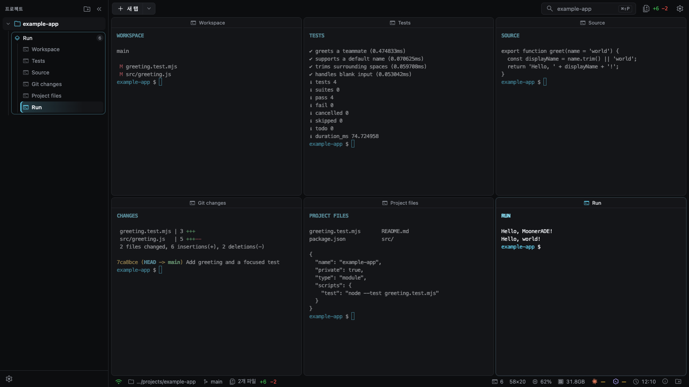
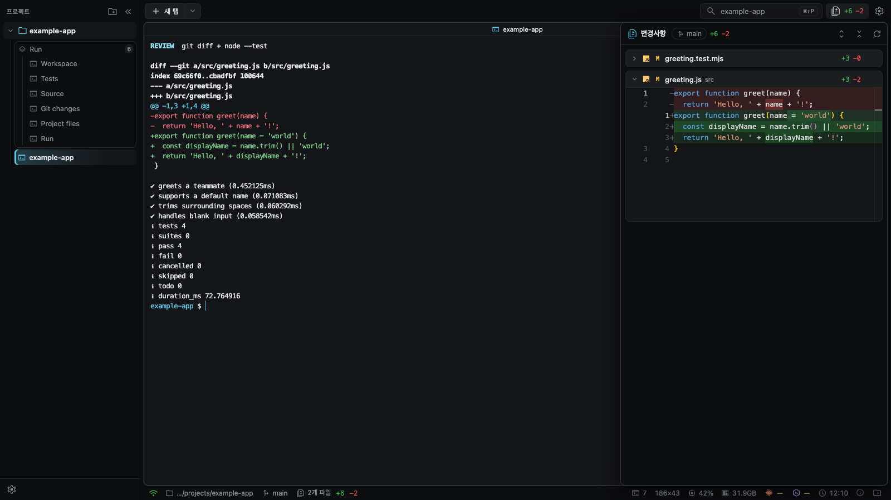

# MoonerADE (무너에이드)

**Claude Code·Codex·Cursor Agent를 한 창에서 사용하는 개발 워크스페이스.**

프로젝트마다 흩어져 있던 터미널을 한곳에 모으고, 여러 에이전트가 일하는 모습을 나란히 보면서 바뀐 코드를 바로 확인하세요. 평소 쓰던 CLI와 계정을 그대로 쓰는 macOS·Windows 데스크톱 앱입니다.

[설치](#설치) · [주요 기능](#주요-기능) · [사용법](#사용법) · [개발](#개발) · [문서](#문서) · [GPL v3](LICENSE)



*예제 프로젝트를 연 실제 앱 화면입니다. 터미널 출력은 데모 코드와 테스트를 실행한 결과입니다.*

## 설치

명령 한 줄이면 최신 버전을 받아 설치하고 바로 실행합니다. 같은 명령을 다시 실행하면 재설치되고, 그 뒤 업데이트는 앱이 알아서 합니다. 관리자 권한은 필요 없습니다.

### macOS (Apple Silicon)

**터미널** 앱을 열고 아래 줄을 붙여 넣으세요.

```sh
curl -fsSL https://raw.githubusercontent.com/Mooner510/mooner-ade/master/scripts/install-mac.sh | sh
```

`/Applications`(쓸 수 없으면 `~/Applications`)에 설치됩니다. 이 방법으로 받으면 "확인되지 않은 개발자" 경고 없이 바로 열립니다.

### Windows (x64)

시작 메뉴에서 **PowerShell**을 열고 아래 줄을 붙여 넣으세요.

```powershell
irm https://raw.githubusercontent.com/Mooner510/mooner-ade/master/scripts/install-windows.ps1 | iex
```

`%LOCALAPPDATA%\Programs\MoonerADE`에 설치되고 시작 메뉴와 바탕 화면에 바로 가기가 생깁니다. SmartScreen 경고도 뜨지 않습니다.

### 설치 후 할 일

MoonerADE는 에이전트를 직접 품지 않고, 컴퓨터에 설치된 공식 CLI를 실행합니다. 쓰려는 도구를 설치하고 한 번 로그인해 두세요.

| 준비물 | 설치 | 로그인 |
|---|---|---|
| [Git](https://git-scm.com/downloads) | 필수 | — |
| [Claude Code](https://docs.anthropic.com/claude-code) | 선택 | `claude auth login` |
| [Codex](https://github.com/openai/codex) | 선택 | `codex login` |
| [Cursor Agent](https://cursor.com/docs/cli/overview) | 선택 | `cursor-agent login` |

그다음 앱에서 **프로젝트 열기**로 작업 폴더를 고르면 끝입니다. 새 탭 메뉴에서 세 에이전트의 터미널 또는 채팅을 선택할 수 있습니다. 채팅은 공식 CLI의 로그인과 세션을 사용하며, CLI가 지원하지 않는 기능은 제한 이유를 표시합니다. 자세한 범위는 [채팅 검증 안내](docs/TESTING_GUIDE.md#codexcursor-agent-채팅-2026-11-10)를 참고하세요.

<details>
<summary>삭제하기</summary>

- **macOS:** 앱을 종료하고 `/Applications/MoonerADE.app`을 휴지통으로 옮깁니다. 설정까지 지우려면 `~/Library/Application Support/mooner-ade`와 `~/Library/Application Support/@mooner/ade-desktop`도 지웁니다.
- **Windows:** 앱을 종료하고 `%LOCALAPPDATA%\Programs\MoonerADE` 폴더와 시작 메뉴·바탕 화면의 `MoonerADE` 바로 가기를 지웁니다. 설정까지 지우려면 `%LOCALAPPDATA%\mooner-ade`와 `%APPDATA%\@mooner\ade-desktop`도 지웁니다.

</details>

<details>
<summary>Intel Mac, Windows ARM 등 다른 환경</summary>

릴리스는 Apple Silicon Mac과 Windows x64용만 만듭니다. Windows ARM은 x64 앱이 에뮬레이션으로 실행됩니다. 그 밖의 환경은 아래 [소스에서 실행](#소스에서-실행)을 따르세요.

</details>

## 주요 기능

| 기능 | 할 수 있는 일 |
|---|---|
| **여러 프로젝트, 한 창** | 프로젝트마다 탭과 터미널을 그대로 둔 채 오가며 작업 |
| **자유로운 터미널 분할** | 좌우·상하 분할, 크기 조절, 최대화, 2 × 3 그리드 한 번에 만들기 |
| **Claude Code · Codex** | 공식 CLI를 실행하고 질문·승인·완료 상태를 한눈에 확인 |
| **다음 요청 예약** | Claude가 일하는 동안 다음 요청을 적어 두면 끝나자마자 전송 |
| **변경사항 Diff** | 바뀐 파일과 추가·삭제 줄 수, 코드 비교를 터미널 옆에서 확인 |
| **작업 환경 유지** | 화면 배치 복원, 테마·글꼴·알림·단축키 설정 |
| **저장소별 worktree** | 여러 저장소가 담긴 폴더에서 저장소마다 작업 경로를 나누고 fast-forward로 합치기 |
| **WakaTime 기록** | 앱 사용 시간과 에이전트 작업 시간을 WakaTime에 기록 (설정 → WakaTime) |
| **자동 업데이트** | 새 버전을 받아 다시 시작해도 실행 중인 터미널과 에이전트 작업은 그대로 유지 |

### 터미널 옆에서 바로 보는 Diff

터미널을 그대로 둔 채 Diff 패널을 열어 파일별 변경을 확인합니다. 크게 보고 싶으면 Diff 탭으로 펼치면 됩니다. 커밋은 터미널이나 에이전트에게 맡깁니다.



## 사용법

1. **프로젝트를 엽니다.** 사이드바에서 프로젝트를 추가하고 작업할 탭을 고릅니다.
2. **터미널을 띄웁니다.** 새 탭 메뉴에서 셸·Claude Code·Codex를 고르거나 직접 명령을 입력합니다. 분할 버튼이나 명령 팔레트로 원하는 배치를 만듭니다.
3. **결과를 확인합니다.** 질문이나 승인을 기다리는 터미널로 이동하고, 오른쪽 Diff 패널에서 바뀐 코드를 검토합니다.

열어 둔 프로젝트와 배치는 자동으로 저장됩니다. 창을 새로고침하면 실행 중이던 터미널에 다시 붙고, 앱을 완전히 껐다 켜면 저장된 배치에 새 셸을 엽니다.

### 자주 쓰는 단축키

`mod`는 macOS에서 ⌘, Windows에서 Ctrl입니다. 그 밖의 Ctrl 조합은 터미널 안의 셸과 CLI로 그대로 전달됩니다.

| 단축키 | 동작 |
|---|---|
| `mod+Alt+O` | 프로젝트 열기 |
| `mod+Shift+T` / `Alt+T` | 새 터미널 탭 |
| `mod+Shift+N` | 새 탭에서 실행할 CLI 고르기 |
| `mod+Shift+P` / `F1` | 명령 팔레트 (분할, 2 × 3 그리드 등) |
| `mod+Shift+Enter` | pane 최대화 켜기/끄기 |
| `mod+Shift+G` | 변경사항 Diff 패널 |
| `mod+,` | 설정 |

전체 단축키와 데이터 복구 방법은 [사용 안내](docs/LOCAL_IDE.md)에 있습니다.

### Claude가 일하는 동안 다음 요청 예약하기

Claude가 작업 중일 때 Claude Code 입력란에 다음 요청을 평소처럼 쓰고 **Tab**을 누르면 예약됩니다(입력란은 비워집니다). 지금 작업이 끝나면 터미널마다 순서대로 자동 전송하고, 목록에서 수정(연필)·취소(X)할 수 있습니다. 작업 중이 아닐 때나 `/`·`@`로 시작하는 입력에서는 Tab이 평소대로 Claude에 전달되고, Codex와 일반 셸의 Tab도 그대로입니다. **Claude Code 2.1.303 이상**에서, ADE에서 새로 연 터미널부터 동작합니다.

<details>
<summary>완료 감지, 호환 조건과 예약 유지 범위</summary>

자동 전송은 Claude의 OSC 7501(없으면 OSC 9;4) 작업 상태 신호와 빈 입력란을 함께 확인하고, 서버에서 Claude 프로세스와 화면 출력 순번을 다시 검증한다. 질문·승인 화면이나 작성 중인 입력이 있으면 기다린다. 구버전, `terminalProgressBarEnabled`가 꺼진 세션, SSH 세션, 신호가 전달되지 않는 tmux 환경에서는 동작하지 않는다. (SSH 원격 tmux의 작업 중·완료 표시는 [docs/LOCAL_IDE.md](docs/LOCAL_IDE.md)의 tmux 설정 참고) 기존 터미널에는 새 환경 설정이 적용되지 않으므로 새 터미널을 열어야 한다.

예약은 일시정지하지 않는다. 중단(Esc/Ctrl+C)이나 오류로 작업이 끝나도, 재접속 후 Claude가 이미 idle이어도 다음 예약을 보낸다. 서버가 전송을 거절하면 다음 갱신 때 다시 시도한다. 예약은 메모리에만 보관하므로 앱 새로고침·종료·pane 재생성 시 사라진다. 텍스트만 지원하며 이미지 첨부는 예약하지 않는다.

</details>

### 자동 업데이트

설치한 앱은 시작 5초 뒤와 10분마다 새 버전을 확인합니다. 새 버전이 있으면 받아서 교체한 뒤 다시 시작하는데, **그동안 터미널은 꺼지지 않습니다.** 앱이 다시 뜨면 열려 있던 터미널에 다시 붙어 그사이 출력까지 보여 주므로, 에이전트가 일하는 중에도 걱정 없이 업데이트됩니다.

<details>
<summary>자세한 동작</summary>

- 새 버전이 없으면 작은 API 호출 한 번으로 끝나고 디스크에는 아무것도 쓰지 않습니다. 코드만 바뀐 릴리스는 그 부분(약 8MB)만 받습니다.
- 앱이 5분 안에 다시 뜨지 않으면 남은 터미널을 정리합니다. 앱을 직접 종료하면 터미널도 함께 종료됩니다.
- 플러그인 세션처럼 재시작을 넘기지 못하는 작업이 있을 때만 먼저 묻습니다. "모두 중단되면 업데이트"를 고르면 그 작업이 끝난 뒤 설치하고, "나중에"를 고른 버전은 앱을 다시 켤 때까지 묻지 않습니다.
- 설정에서 업데이트를 직접 확인하거나, 대기 중인 업데이트를 취소·강제할 수 있습니다.
- 소스에서 실행한 앱(`pnpm dev`, `pnpm start`)은 자동 업데이트하지 않습니다.
- macOS 앱은 Apple 공증 없이 ad-hoc 서명되어 있고, 스스로 업데이트하려면 쓰기 가능한 폴더(예: `/Applications`)에 있어야 합니다.

</details>

## 로컬 실행과 데이터

MoonerADE는 내 컴퓨터 한 대에서, 나 혼자 쓰는 것을 전제로 동작합니다. 공식 CLI의 계정과 권한 설정을 그대로 쓰고, 터미널은 앱을 실행한 사용자의 셸 권한을 가집니다. 모델을 쓰려면 해당 제공자의 이용 권한이 필요합니다.

프로젝트 목록·배치·설정과 터미널별 에이전트 세션 기록은 OS별 앱 데이터 폴더에 저장됩니다. 경로는 [환경 변수](ENVIRONMENT_VARIABLES.md), 접속 토큰과 데이터 취급은 [보안 경계](docs/SECURITY_REVIEW.md)에 정리되어 있습니다.

## 개발

### 소스에서 실행

[Node.js](https://nodejs.org/) **24.21.0 이상**, pnpm **11.27.1**(`corepack enable`로 켜짐), Git이 필요합니다. `node-pty`를 빌드하느라 OS의 네이티브 빌드 도구(macOS는 Xcode Command Line Tools, Windows는 Visual Studio Build Tools)가 필요할 수 있습니다.

```sh
git clone https://github.com/Mooner510/mooner-ade.git
cd mooner-ade
pnpm install --frozen-lockfile
pnpm start   # 웹 UI를 빌드하고 앱 실행
pnpm dev     # 개발 모드: 웹 HMR + 서버 변경 시 재시작
```

개발 모드에서도 서버가 바뀌는 동안 PTY 호스트가 터미널을 붙잡고 있습니다. Electron 메인 코드와 PTY 호스트를 고쳤다면 앱을 직접 다시 시작하세요.

<details>
<summary>검사 명령과 프로젝트 구조</summary>

```sh
pnpm typecheck    # 웹 타입 검사
pnpm check        # 웹 타입 검사 + Node 테스트
pnpm e2e          # 웹 빌드 후 실제 Chrome/PTY로 UI 검증, 모델 호출 없음
pnpm audit        # lockfile 의존성 보안 검사
```

| 경로 | 역할 |
|---|---|
| `apps/desktop` | Electron 셸과 로컬 서버 실행 |
| `apps/web` | React UI, 터미널, 읽기 전용 Monaco Diff |
| `apps/local-server` | 루프백 HTTP/WebSocket, 프로젝트·Git·PTY·세션 복구 API |

자세한 구조는 [아키텍처](docs/ARCHITECTURE.md)를 참고하세요. 기여는 `feature/*` → `master` PR과 `.github/workflows/ci.yml`의 재사용 CI를 따릅니다. OS별 검증 범위는 [검증 상태](docs/VERIFICATION.md)에 있습니다.

</details>

<details>
<summary>앱 빌드와 릴리스</summary>

`pnpm package`는 현재 OS용 앱을 만듭니다. macOS는 `apps/desktop/dist/MoonerADE.app`, Windows는 `apps/desktop/dist/MoonerADE-win32-<arch>/MoonerADE.exe`가 생깁니다. Node 런타임과 네이티브 PTY 모듈까지 들어 있으므로 Windows 빌드는 Windows에서, macOS 빌드는 macOS에서 만들어야 합니다.

릴리스는 `package.json`의 `version`을 올려 커밋한 뒤 아무 컴퓨터에서 `pnpm release`를 한 번 실행하면 됩니다. 현재 커밋에 `v<version>` 태그를 달아 푸시하면 `Release` 워크플로가 GitHub 릴리스를 만들고, macOS(arm64)와 Windows(x64) 빌드(`MoonerADE-darwin-arm64.zip`, `MoonerADE-win32-x64.zip`)를 올립니다. 설치 스크립트와 앱의 자동 업데이트가 이 파일을 받습니다.

- GitHub의 Actions 탭에서 태그를 넣어 직접 실행할 수도 있습니다. 이미 있는 태그를 넣으면 그 릴리스를 다시 빌드합니다.
- 현재 OS용 빌드만 직접 올리려면 `pnpm release:local`을 실행합니다.

</details>

## 문서

- [로컬 실행·단축키·데이터 복구](docs/LOCAL_IDE.md)
- [검증 결과와 확인 범위](docs/VERIFICATION.md) · [테스트 실행 안내](docs/TESTING_GUIDE.md)
- [아키텍처](docs/ARCHITECTURE.md)
- [환경 변수](ENVIRONMENT_VARIABLES.md) · [보안 경계](docs/SECURITY_REVIEW.md)

## 라이선스

Copyright (C) 2026 mooner-ade contributors.

이 프로젝트는 **GNU General Public License version 3 only (`GPL-3.0-only`)**로 배포합니다. GPL v3 조건에 따라 사용·수정·재배포할 수 있으며, 어떠한 보증도 제공하지 않습니다. 전문은 [LICENSE](LICENSE)를 참고하세요. 포함하거나 사용하는 외부 라이브러리·아이콘·폰트에는 각 저작권자와 라이선스의 고지가 적용됩니다. 번들 글꼴(Inter, Noto Sans KR, JetBrains Mono)은 SIL OFL 1.1이며 라이선스 전문은 빌드 결과의 `licenses/`에 들어 있습니다.
