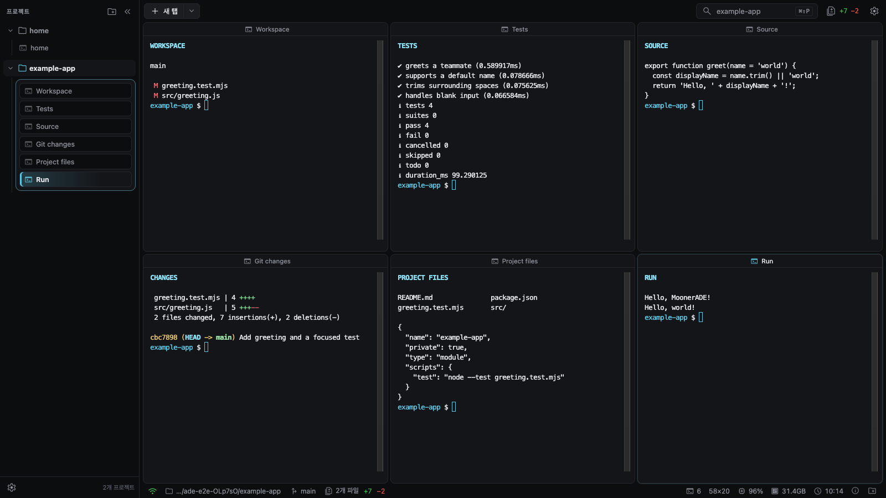
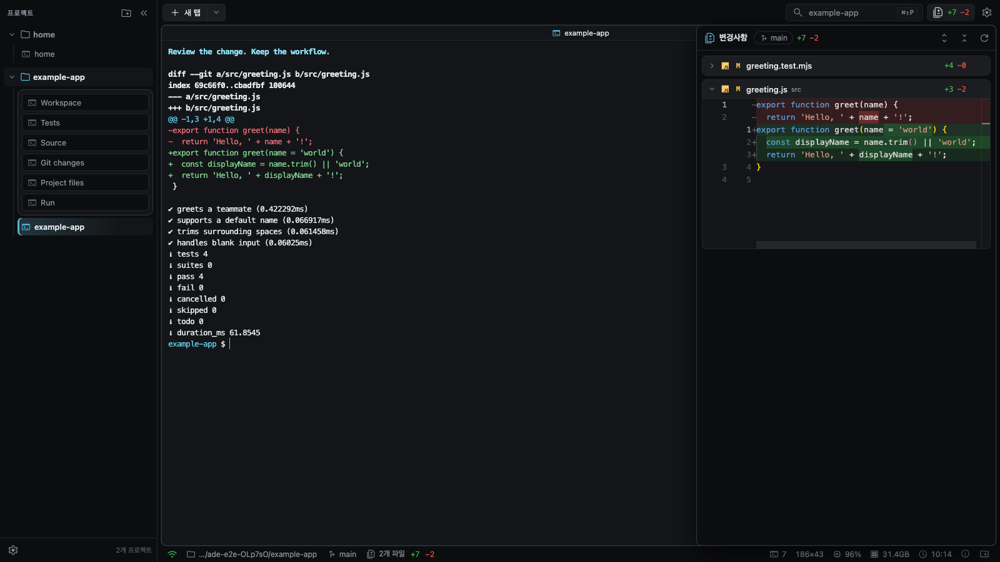

# MoonerADE (무너에이드)

**Claude Code와 Codex를 위한 로컬 터미널 워크스페이스.**

프로젝트마다 흩어진 터미널을 한 창에 모으고, 여러 에이전트의 작업을 오가며 코드 변경을 바로 확인하세요. 익숙한 CLI와 사용자 계정을 그대로 사용하는 Electron 데스크톱 앱입니다. 브라우저에서도 실행할 수 있습니다.

[빠른 시작](#빠른-시작) · [주요 기능](#주요-기능) · [사용 흐름](#사용-흐름) · [개발과 검증](#개발과-검증) · [문서](#문서) · [GPL v3](LICENSE)



*실제 앱에서 예제 프로젝트를 열어 촬영한 화면입니다. 터미널 출력은 데모 코드와 테스트의 실행 결과입니다.*

## 주요 기능

| 기능 | 할 수 있는 일 |
|---|---|
| **여러 프로젝트, 한 창** | 프로젝트별 탭과 터미널을 유지하면서 작업 전환 |
| **자유로운 터미널 분할** | 좌우·상하 분할, 크기 조절, 최대화, 2 × 3 프리셋 |
| **Claude Code · Codex** | 공식 CLI 실행과 질문·승인·완료 상태 확인 |
| **작업 뒤에 이어지는 입력** | Claude가 작업하는 동안 다음 요청을 예약하고 완료 후 전송 |
| **변경사항 Diff** | HEAD 대비 변경 파일, 추가·삭제 줄 수와 읽기 전용 코드 비교 |
| **내 작업 환경 유지** | 화면 배치 복원, 테마·글꼴·알림·단축키 설정 |
| **선택하는 worktree** | 작업 경로 분리와 fast-forward 통합 |

### 터미널 옆에서 변경사항 확인

작업 중인 터미널을 유지한 채 Diff 패널을 열고, 파일별 변경을 확인합니다. 더 크게 보고 싶으면 Diff 탭으로 펼칠 수 있습니다. 커밋은 터미널이나 에이전트에서 진행합니다.



## 빠른 시작

### 준비

| 항목 | 요구사항 |
|---|---|
| Node.js | **24.21.0 이상** |
| pnpm | **11.27.1** |
| Git | 로컬 설치 |
| Claude Code / Codex | 사용할 공식 CLI를 별도로 설치하고 로그인 |

`node-pty` 설치에 OS의 네이티브 빌드 도구가 필요할 수 있습니다. 현재 OS별 검증 범위는 [검증 상태](docs/VERIFICATION.md)를 참고하세요.

### 설치하고 실행

```sh
git clone https://github.com/Mooner510/mooner-ade.git
cd mooner-ade
pnpm install --frozen-lockfile
pnpm desktop
```

`pnpm desktop`은 웹 UI를 빌드하고 Electron 앱을 엽니다. 앱에서 프로젝트 폴더를 선택한 뒤 터미널에서 작업을 시작하세요.

에이전트 CLI를 처음 사용하는 경우, 사용할 제공자의 로그인을 먼저 완료합니다.

```sh
claude auth login
codex login
```

<details>
<summary>브라우저에서 실행하기</summary>

```sh
pnpm web:build
pnpm start
```

서버가 출력한 `http://127.0.0.1:<port>/#token=...` 링크를 엽니다. 이 링크는 로컬 파일과 터미널에 접근할 수 있는 자격증명이므로 공유하지 마세요. 접속 후 토큰은 주소에서 제거됩니다.

</details>

## 사용 흐름

1. **프로젝트를 엽니다.** 사이드바에서 프로젝트를 추가하고 작업할 탭을 선택합니다.
2. **터미널에서 실행합니다.** 새 탭 메뉴에서 셸·Claude Code·Codex를 고르거나 직접 명령을 입력합니다. 분할 버튼과 명령 팔레트로 원하는 배치를 만듭니다.
3. **변경을 확인합니다.** 질문이나 승인이 필요한 터미널로 이동하고, 오른쪽 Diff 패널에서 코드 변경을 검토합니다.

배치와 열린 프로젝트는 저장됩니다. 브라우저 새로고침은 실행 중인 서버의 터미널에 다시 연결하며, 앱을 완전히 종료한 뒤에는 저장한 배치에 새 셸을 엽니다.

### 자주 쓰는 단축키

`mod`는 macOS에서 ⌘, 그 외에는 Ctrl입니다. 터미널의 일반 Ctrl 조합은 셸과 CLI로 전달합니다.

| 단축키 | 동작 |
|---|---|
| `mod+Alt+O` | 프로젝트 열기 |
| `mod+Shift+T` / `Alt+T` | 새 터미널 탭 |
| `mod+Shift+N` | 새 탭에서 실행할 CLI 선택 |
| `mod+Shift+P` / `F1` | 명령 팔레트: 분할·프리셋 등 |
| `mod+Shift+Enter` | pane 최대화 전환 |
| `mod+Shift+G` | 변경사항 Diff 패널 |
| `mod+,` | 설정 |

전체 키와 데이터 복구 방법은 [사용 안내](docs/LOCAL_IDE.md)를 참고하세요. 브라우저가 선점하는 단축키는 명령 팔레트나 대체 키를 사용합니다.

## Claude Code terminal follow-up

Claude가 작업하는 동안 Claude Code 입력란에 평소처럼 다음 요청을 쓰고 **Tab**을 누르면 예약됩니다(입력란은 비워집니다). 현재 작업이 끝나면 터미널별 순서대로 자동 전송하며, 목록에서 수정(연필)·취소(X)할 수 있습니다. 작업 중이 아니거나 `/`·`@`로 시작하는 입력의 Tab은 Claude로 그대로 전달됩니다. Codex와 일반 셸의 Tab 동작은 유지합니다. **Claude Code 2.1.303 이상**의 새 ADE 터미널에서 지원합니다.

<details>
<summary>완료 감지, 호환 조건과 예약 유지 범위</summary>

자동 전송은 Claude의 OSC 7501(없으면 OSC 9;4) 작업 상태 신호와 빈 입력란을 함께 확인하고, 서버에서 Claude 프로세스와 화면 출력 순번을 다시 검증한다. 질문·승인 화면이나 작성 중인 입력이 있으면 기다린다. 구버전, `terminalProgressBarEnabled`가 꺼진 세션, SSH 세션, 신호가 전달되지 않는 tmux 환경에서는 동작하지 않는다. 기존 터미널에는 새 환경 설정이 적용되지 않으므로 새 터미널을 열어야 한다.

예약은 일시정지하지 않는다. 중단(Esc/Ctrl+C)이나 오류로 작업이 끝나도, 재접속 후 Claude가 이미 idle이어도 다음 예약을 보낸다. 서버가 전송을 거절하면 다음 갱신 때 다시 시도한다. 예약은 메모리에만 보관하므로 앱 새로고침·종료·pane 재생성 시 사라진다. 텍스트만 지원하며 이미지 첨부는 예약하지 않는다.

</details>

## 로컬 실행과 데이터

MoonerADE는 단일 사용자의 로컬 PC를 기준으로 동작합니다. 공식 CLI의 계정과 권한 설정을 사용하며, 터미널은 실행 사용자의 셸 권한을 갖습니다. 모델 이용에는 해당 제공자의 이용 권한이 필요합니다.

프로젝트 목록·배치·프롬프트·실행 이벤트 등은 OS별 앱 데이터 폴더에 저장합니다. 경로는 [환경 변수](ENVIRONMENT_VARIABLES.md), 접속 토큰과 데이터 취급은 [보안 경계](docs/SECURITY_REVIEW.md)에 설명되어 있습니다.

## 개발과 검증

```sh
pnpm desktop:dev  # 웹 HMR + 서버 변경 시 재시작
```

개발 모드에서는 별도 PTY 호스트가 서버 교체 중 터미널을 유지합니다. Electron 메인 코드와 PTY 호스트 변경은 앱을 직접 재시작해야 반영됩니다.

<details>
<summary>검사 명령과 프로젝트 구조</summary>

```sh
pnpm typecheck    # 패키지 계약 + 웹 타입 검사
pnpm check        # 패키지 import + 계약 타입 + Node 테스트
pnpm web:build    # 웹 타입 검사 + Vite 번들
pnpm smoke        # 프레임워크 파일 조회 + 자식 프로세스 실행
pnpm e2e          # 실제 Chrome/PTY 검증, 모델 호출 없음
pnpm audit        # lockfile 의존성 보안 검사
```

`pnpm build`는 프레임워크 import 검사입니다. 웹 빌드와 브라우저 검증은 각각 `web:build`, `e2e`로 실행합니다. 실제 모델 검증은 사용량이 발생하는 명시적 opt-in입니다: `ADE_LIVE_TEST=1 pnpm test:live`.

| 경로 | 역할 |
|---|---|
| `apps/desktop` | Electron 셸과 로컬 서버 실행 |
| `apps/web` | React UI, 터미널, 읽기 전용 Monaco Diff |
| `apps/local-server` | 루프백 HTTP/WebSocket, 프로젝트·PTY·에이전트·저장 API |
| `packages/*` | core, protocol, local runtime, CLI adapters, session store, recorded runner |

앱은 터미널과 Diff를 중심으로 구성되어 있습니다. 재사용 프레임워크에는 별도의 파일·Git·에이전트 API가 있습니다. 자세한 계약은 [아키텍처](docs/ARCHITECTURE.md)를 참고하세요.

기여는 `feature/*` → `master` PR과 `.github/workflows/ci.yml`의 재사용 CI를 따릅니다.

</details>

## 문서

- [로컬 실행·단축키·데이터 복구](docs/LOCAL_IDE.md)
- [검증 결과와 확인 범위](docs/VERIFICATION.md) · [테스트 실행 안내](docs/TESTING_GUIDE.md)
- [아키텍처와 프레임워크 계약](docs/ARCHITECTURE.md) · [이벤트 계약](docs/P1_EVENT_CONTRACT.md)
- [환경 변수](ENVIRONMENT_VARIABLES.md) · [보안 경계](docs/SECURITY_REVIEW.md)
- [호스팅 환경으로 이식할 때의 경계](docs/PORTING.md)

## 라이선스

Copyright (C) 2026 mooner-ade contributors.

이 프로젝트는 **GNU General Public License version 3 only (`GPL-3.0-only`)**로 배포합니다. GPL v3 조건에 따라 사용·수정·재배포할 수 있으며, 어떠한 보증도 제공하지 않습니다. 전문은 [LICENSE](LICENSE)를 참고하세요. 포함하거나 사용하는 외부 라이브러리·아이콘·폰트에는 각 저작권자와 라이선스의 고지가 적용됩니다.
